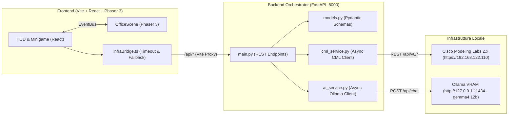

# Relazione Tecnica & Blueprint Architetturale — Cisco Cyber Office (Hackathon)

Questo documento descrive l'architettura modulare **End-to-End** realizzata nella Milestone M4 e funge da guida operativa per costruire da zero il progetto reale dell'hackathon.

---

## 1. Architettura Generale (3-Tier + Dual-Mode)



### Regola d'Oro: Dual-Mode (`Live Infrastructure + Deterministic Fallback`)
Il sistema **non deve mai bloccarsi** se CML o Ollama sono spenti (es. in CI/CD, su Proxmox o durante una demo offline):
- Ogni chiamata HTTP in `src/utils/infraBridge.ts` usa `AbortController` con timeout dedicato (`1500ms` per CML/health, `5000ms` per bootstrap lab, `10000ms` per LLM).
- Ogni servizio Python (`cml_service.py`, `ai_service.py`) intercetta timeout/eccezioni e restituisce un payload compatibile marcato `mode: "fallback_sim"` / `source: "fallback_sim"`.

---

## 2. Struttura Modulare dello Scheletro

### Backend (`backend/`)
- `backend/__init__.py`: definisce il package Python.
- `backend/models.py`: schemi Pydantic (`PatchRequest`, `TerminalCommandRequest`, `SocSinkholeRequest`, `AiInteractRequest`) separati dalle rotte.
- `backend/cml_service.py`: client asincrono `httpx` verso `/api/v0/...` con `verify=False`, gestione token Bearer, auto-provisioning del lab `FuoriRete_Office` (`SW-CORE-01` `ioll2-xe` + `RTR-EDGE-01` `iol-xe`) e controllo stato nodi/interfacce.
- `backend/ai_service.py`: client asincrono verso Ollama (`/api/chat`) con prompt di sistema per i personaggi (`marco`, `ciro`, `rosaria`, `secbot`) e modalità `hint` JSON per i minigame.
- `backend/main.py`: API FastAPI con CORS abilitato, telemetria in-memory (`SESSION_TELEMETRY`) e persistenza DNS sinkhole su `backend/blocked.hosts`.
- `backend/.env.example`: template variabili d'ambiente (`CML_URL`, `CML_USER`, `CML_PASS`, `CML_LAB_TITLE`, `OLLAMA_URL`, `OLLAMA_MODEL`, `INFRA_TIMEOUT_MS`).

### Frontend (`src/`)
- `vite.config.ts`: proxy `/api` -> `http://127.0.0.1:8000` per evitare problemi CORS in sviluppo e via tunnel.
- `src/utils/infraBridge.ts`: singleton client con coda log reattiva (`subscribe()`) per mostrare latenza e stato (`LIVE` vs `SIM`) nell'HUD.
- `src/components/InfraMonitorBadge.tsx`: badge compatto nell'HUD con drawer **Live Infrastructure Monitor** e pulsante **Sync / Bootstrap CML Lab**.
- `src/components/NpcDialogueBox.tsx`: componente riutilizzabile per dialoghi NPC, scelte multiple, quick-prompt AI (`Cosa devo fare ora?`, `Stato lab CML`, `Dammi un indizio`) e chat libera.
- `src/components/HabboOffice.tsx`: orchestratore della mappa Phaser, spostamenti rapidi e stato missioni.
- Minigame collegati: `PatchRackGame.tsx`, `CrtTerminalGame.tsx`, `UmbrellaSocGame.tsx`.

---

## 3. Contratti API Principali

| Metodo & Endpoint | Payload | Scopo |
| :--- | :--- | :--- |
| `GET /api/health` | — | Verifica stato live CML + Ollama e contatori telemetria |
| `POST /api/cml/bootstrap-demo` | `{}` | Crea/avvia il lab demo su CML se assente |
| `POST /api/rack/patch` | `{port_id, cable_id, connected}` | Registra patch L1/L2 e pilota nodo/porta su CML |
| `POST /api/terminal/command` | `{node, command}` | Inoltra comandi IOS CLI e aggiorna telemetria |
| `POST /api/soc/sinkhole` | `{domain, action}` | Aggiorna blocklist DNS locale (`blocked.hosts`) |
| `POST /api/ai/interact` | `{mode, npc_id, prompt, minigame, context}` | Chat NPC live o hint strutturato JSON via Ollama |

---

## 4. Lezioni Chiave & Best Practice per Ripartire da Zero

1. **Modelli "Thinking" su Ollama (es. `gemma4:12b`):**
   - Di default i modelli con capability `thinking` consumano i token nel campo `thinking` lasciando `content` vuoto.
   - Passare **sempre** `"think": False` nel payload `/api/chat` insieme a `"keep_alive": -1`, `"num_ctx": 1024`, `"num_predict": 120` per ottenere risposte in ~200ms.
2. **Non bloccare le chiamate AI su I/O di rete verso CML:**
   - `/api/ai/interact` deve leggere lo stato cached (`cml_service._lab_id`, `SESSION_TELEMETRY`) invece di fare una chiamata HTTP sincrona a CML prima di interrogare Ollama.
3. **Conflitto Tastiera Phaser vs Input React:**
   - Phaser registra listener globali su `window` per `WASD`, `E`, `Spazio`.
   - Su ogni `<input>` / `<textarea>` React sovrapposto al canvas Phaser è obbligatorio aggiungere `onKeyDown` e `onKeyUp` con `e.stopPropagation(); e.nativeEvent.stopImmediatePropagation();`.
4. **Priorità UI nei pannelli contestuali:**
   - Quando l'utente clicca per aprire un dialogo NPC mentre è sopra uno spot interattivo, azzerare `activeSpot` (o dare priorità a `dialogue` nel rendering) per evitare che il banner dello spot copra il box di dialogo.
5. **Layout Viewport-First:**
   - Limitare il canvas Phaser (`max-h-[38vh]`) e mantenere l'header compatto in modo che mappa, pulsanti rapidi e chat AI stiano sempre in una sola schermata senza scroll.

---

## 5. Checklist Rapida per Domani (Da Zero all'Hackathon)

1. **Setup Backend:**
   ```bash
   cp backend/.env.example backend/.env   # impostare CML_PASS
   python3 -m venv backend/.venv
   source backend/.venv/bin/activate
   pip install -r backend/requirements.txt
   ```
2. **Verifica Infrastruttura Locale:**
   ```bash
   ping -c 1 192.168.122.110
   curl -s http://127.0.0.1:11434/api/tags
   ```
3. **Avvio Unificato:**
   ```bash
   ./start_demo.sh
   ```
4. **Verifica Build & QA:**
   ```bash
   npm run build
   node pipeline/run_qa_suite.mjs
   ```
